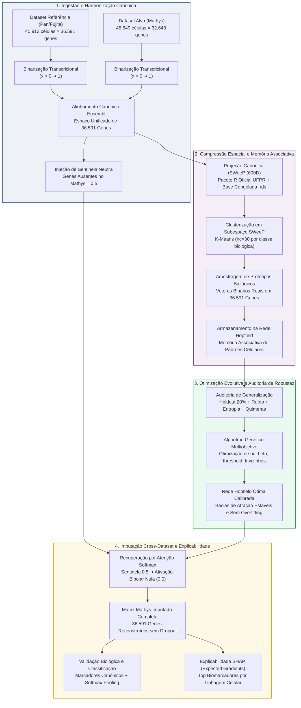

# Pipeline Hopfield & rSWeeP para scRNA-seq

[](https://www.python.org/downloads/)
[](https://github.com/astral-sh/uv)
[-brightgreen.svg)](https://bioconductor.org/packages/rSWeeP)
[](https://pytorch.org/)
[](LICENSE)
[](tests/)
[](https://github.com/astral-sh/ruff)

> **Aplicação de Projeções SWeeP e Machine Learning para Recuperação de Perfis Transcriptômicos e Integração de Dados de RNA-seq de Célula Única (scRNA-seq)**  
> *Pesquisa de Mestrado desenvolvida no Laboratório de Inteligência Artificial e Biologia Integrativa (AIBIALab / UFPR)*

---

## 🔬 1. Visão Geral e Contexto Biológico

O sequenciamento de RNA de célula única (**scRNA-seq**) viabilizou a caracterização de programas transcricionais em resolução unicelular. Entretanto, estudos multicêntricos enfrentam desafios metodológicos fundamentais:
- **Alta Dimensionalidade e Custo:** Matrizes massivas com mais de 30.000 genes por dezenas de milhares de células.
- **Ruído Técnico e Dropouts:** Perda artificial de contagens transcricionais por limitações na captura de RNAm.
- **Efeito de Lote (Batch Effect) e Genes Ausentes:** Plataformas e painéis genômicos distintos resultam em espaços de features incompletos entre coortes de referência e alvo (ex.: ~6.279 genes nativos presentes no atlas de referência Pan/Fujita ausentes no sequenciamento alvo Mathys).

Para superar essas barreiras sem recorrer a modelos de *deep learning* "caixa-preta" que causam hipercorreção (*overcorrection*), este projeto implementa um pipeline associativo integrando:
1. **rSWeeP (Spaced Words Projection - 600D):** Redução dimensional espectral e ortonormal sem alinhamento desenvolvida na UFPR (De Pierri et al., 2020), preservando a geometria biológica (Lema de Johnson-Lindenstrauss).
2. **Modern Hopfield Network (Redes Hopfield Modernas):** Memória associativa densa de padrão contínuo (Ramsauer et al., 2020; Krotov & Hopfield, 2016) com atenção contínua Softmax e injeção de **valor sentinela neutro 0.5** para genes ausentes.
3. **Otimização Evolutiva por Algoritmo Genético:** Calibração automatizada de hiperparâmetros (temperatura beta, limiares de corte e cardinalidade de protótipos) com salvaguardas estritas contra overfitting e estados quiméricos.
4. **Explicabilidade Genômica via SHAP:** Ranqueamento e identificação de biomarcadores celulares chave via gradientes esperados aplicados à função de atenção.

---

## 📐 2. Diagrama Conceitual do Pipeline (Visão Científica)

O fluxo metodológico abaixo ilustra as quatro grandes fases de transformação dos dados:



> 📖 **Para o Diagrama Técnico-Operacional completo** (com mapeamento detalhado dos módulos de `src/`, arquivos `.h5ad`, `.mtx`, `.rds`, `.npy`, `.pt` e fluxo de tensores), consulte o documento de especificação:  
> 🔗 **[`docs/pipeline_pan_mathys.md`](docs/pipeline_pan_mathys.md)**

---

## 🗂️ 3. Estrutura do Repositório

```text
pipiline_hopifield/
├── docs/                                  # Documentações formais e diagramas do projeto
│   └── pipeline_pan_mathys.md             # Especificação e diagramas Mermaid de ponta a ponta
├── second_brain/                          # Grafo de Conhecimento Científico (PARA + OKF + Wikilinks)
│   ├── 01_Projetos/                       # Projetos ativos, proposta de mestrado e metas
│   ├── 02_Areas/                          # Áreas científicas (scRNA-seq, DAM, SWeeP)
│   ├── 03_Conhecimento/                   # Notas atômicas teóricas e biológicas
│   └── 04_Recursos/adrs/                  # Registros Formais de Decisão de Arquitetura (ADRs)
├── src/                                   # Código-fonte modular da biblioteca Python
│   ├── alinhamento/                       # Leitura de features, alinhador Ensembl e exportação MTX
│   ├── preprocessing/                     # Binarização OOM-Safe de matrizes scRNA-seq
│   ├── treinamento/                       # Projetor rSWeeP (R), Rede Hopfield, AG e SHAP
│   └── utils/                             # Utilitários de integridade Git Fail Fast
├── tests/                                 # Suíte abrangente de testes unitários (pytest)
├── pipeline_generico_Pan_Mathys.ipynb     # Notebook de execução interativa (espelhado em .py)
├── pipeline_generico_Pan_Mathys.py        # Script pareado via Jupytext (formato percentual)
├── pyproject.toml                         # Configuração unificada de dependências, ruff e pytest
└── README.md                              # Guia de apresentação principal do repositório
```

---

## 🚀 4. Instalação e Execução

### Pré-requisitos
- **Python:** Versão `>= 3.10` gerenciada exclusivamente via [`uv`](https://github.com/astral-sh/uv).
- **R:** Ambiente R (versão `>= 4.0`) com os pacotes `Matrix` e `rSWeeP` da UFPR instalados.

---

### Opção A: Execução Local (Terminal e Scripts)

1. **Clone o repositório:**
   ```bash
   git clone https://github.com/letdevx/pipiline_hopifield.git
   cd pipiline_hopifield
   ```

2. **Instale e sincronize o ambiente virtual via `uv`:**
   ```bash
   uv sync
   ```

3. **Verifique as dependências do ambiente R:**
   ```bash
   uv run python -c "from treinamento.projetor_sweep import ProjetorSWeePR; ProjetorSWeePR.verificar_e_instalar_dependencias_r()"
   ```

4. **Execute a suíte de testes unitários:**
   ```bash
   uv run pytest
   ```

5. **Execute a checagem de qualidade e tipagem estática:**
   ```bash
   uv run ruff check .
   uv run pyrefly check
   ```

---

### Opção B: Execução em Nuvem (Google Colab)

O repositório é totalmente compatível com a execução em GPU no **Google Colab**:
1. Abra o arquivo [`pipeline_generico_Pan_Mathys.ipynb`](pipeline_generico_Pan_Mathys.ipynb) no Google Colab.
2. Monte o Google Drive contendo as matrizes de entrada brutas (`.h5ad` e `features.tsv`).
3. O notebook possui o validador **Fail Fast de Integridade Git (ADR 024)**: defina a variável `EXPECTED_COMMIT` com o hash mais recente do seu branch (ex.: `"c0b4068"`), prevenindo a execução de códigos desatualizados.
4. Execute as células em sequência para acionar o pipeline fim a fim.

---

## 📊 5. Tabela de Dimensões Matriciais do Pipeline

| Etapa | Matriz / Objeto | Dimensão (Células × Genes/Dimensões) | Formato em Disco | Função no Pipeline |
| :--- | :--- | :--- | :--- | :--- |
| **Referência Bruta** | `adata_ref` | 40.913 × 36.591 genes | `.h5ad` | Matriz de treino e protótipos celulares (Pan/Fujita) |
| **Alvo Bruto** | `adata_alvo` | 45.549 × 32.643 genes | `.h5ad` | Coorte com genes ausentes a serem imputados (Mathys) |
| **Alvo Alinhado** | `W_mathys` | 45.549 × 36.591 genes | `.mtx` / `.h5ad` | Alinhamento canônico Ensembl com sentinela 0.5 |
| **Projeção SWeeP** | `Wswp` | 40.913 × 600 dimensões | `.txt` | Embeddings latentes calculados via `rSWeeP` oficial |
| **Protótipos Hopfield** | `perf180` / `perf_otimo` | 180 a 210 padrões × 36.591 genes | `.pt` / `.json` | Memórias estáveis dos tipos celulares no córtex |
| **Alvo Imputado** | `Wrecuperado_m` | 45.549 × 36.591 genes | `.h5ad` CSR + `.npy` | Reconstrução contínua e categórica de expressão |
| **Features SHAP** | `df_features_shap` | 3.000 genes ranqueados | `.csv` / `.png` | Biomarcadores celulares ordenados por especificidade |

---

## 🏛️ 6. Decisões Formais de Arquitetura (ADRs em Destaque)

O projeto segue governança rigorosa de decisões científicas registradas no *Second Brain*:
- **[`ADR 001`](second_brain/04_Recursos/adrs/adr_001_binarizacao_expressao_genica.md):** Binarização de expressão gênica para modelagem por atratores discretos.
- **[`ADR 002`](second_brain/04_Recursos/adrs/adr_002_sentinela_meio_genes_ausentes.md):** Utilização do valor sentinela neutro 0.5 para cancelamento de bias em genes ausentes.
- **[`ADR 019`](second_brain/04_Recursos/adrs/adr_019_obrigatoriedade_rsweep_r_e_congelamento_orthbase.md):** Obrigatoriedade irrevogável do pacote R `rSWeeP` da UFPR e eliminação total de fallbacks sintéticos.
- **[`ADR 020`](second_brain/04_Recursos/adrs/adr_020_resolucao_sentinela_e_validacao_multinivel_imputacao.md):** Protocolo de validação multinível e auditoria biológica de marcadores específicos do cérebro.
- **[`ADR 021`](second_brain/04_Recursos/adrs/adr_021_centralizacao_orthbase_config_e_reuso_canonico.md):** Centralização da base congelada `orthbase_mproj_600d.rds` via `config.py`.
- **[`ADR 022`](second_brain/04_Recursos/adrs/adr_022_otimizacao_hiperparametros_algoritmo_genetico.md):** Motor de calibração evolutiva via Algoritmo Genético multiobjetivo.
- **[`ADR 023`](second_brain/04_Recursos/adrs/adr_023_selecao_features_shap_hopfield.md):** Explicabilidade genômica e extração de biomarcadores via SHAP GradientExplainer.
- **[`ADR 024`](second_brain/04_Recursos/adrs/adr_024_validacao_fail_fast_commit_colab.md):** Validação *Fail Fast* de integridade de commit Git no Google Colab.

---

## 👥 7. Equipe e Filiação Acadêmica

- **Pesquisadora (Discente de Mestrado):** Leticia Astolpho Silvano  
- **Orientador:** Prof. Dr. Roberto Tadeu Raittz  
- **Coorientadora:** Dra. Camila Pereira Perico  
- **Laboratório:** [Laboratório de Inteligência Artificial e Biologia Integrativa (AIBIALab)](https://aibialab.github.io)  
- **Programa:** Pós-Graduação em Bioinformática — Universidade Federal do Paraná (**UFPR**), Curitiba, PR, Brasil.

---

## 📜 8. Citação e Referências Fundacionais

Caso utilize este código ou metodologia em suas pesquisas, cite:

```bibtex
@mastersthesis{silvano2026hopfield,
  title  = {Aplicação de Projeções SWeeP e machine learning para recuperação de perfis transcriptômicos e integração de conjuntos de dados de RNA-seq},
  author = {Silvano, Leticia Astolpho},
  school = {Universidade Federal do Paraná (UFPR)},
  year   = {2026},
  type   = {Dissertação de Mestrado},
  note   = {Orientador: Prof. Dr. Roberto Tadeu Raittz. Coorientadora: Dra. Camila Pereira Perico.}
}
```

### Principais Artigos de Referência
1. **SWeeP:** De Pierri, C. R., Voyceik, R., Santos de Mattos, L. G. C., Kulik, M. G., Camargo, J. O., Repula de Oliveira, A. M., ... & Raittz, R. T. (2020). *SWeeP: representing large biological sequences datasets in compact vectors*. **Scientific Reports**, 10(1), 91. [DOI: 10.1038/s41598-019-55627-8](https://doi.org/10.1038/s41598-019-55627-8)
2. **Modern Hopfield Networks:** Ramsauer, H., Schäfl, B., Lehner, J., Seidl, P., Widrich, M., Gruber, L., ... & Hochreiter, S. (2020). *Hopfield Networks is All You Need*. **ICLR 2021**. [arXiv:2008.02217](https://arxiv.org/abs/2008.02217)
3. **Dense Associative Memory:** Krotov, D., & Hopfield, J. J. (2016). *Dense associative memory for pattern recognition*. **Advances in Neural Information Processing Systems (NeurIPS)**, 29.
4. **Artigo Fundacional de Hopfield:** Hopfield, J. J. (1982). *Neural networks and physical systems with emergent collective computational abilities*. **Proceedings of the National Academy of Sciences (PNAS)**, 79(8), 2554-2558.
