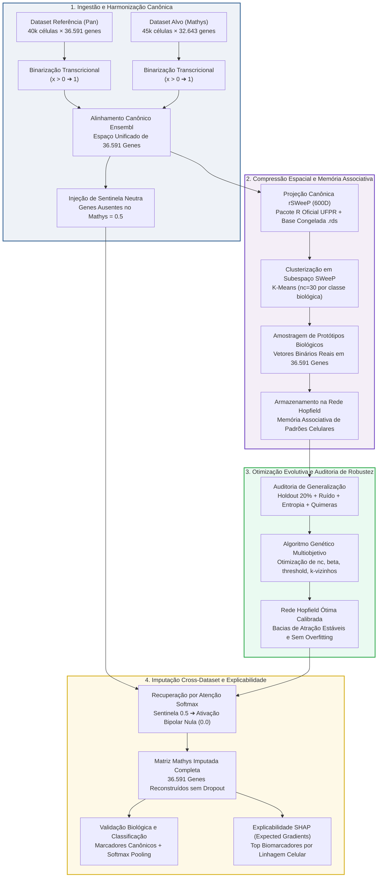
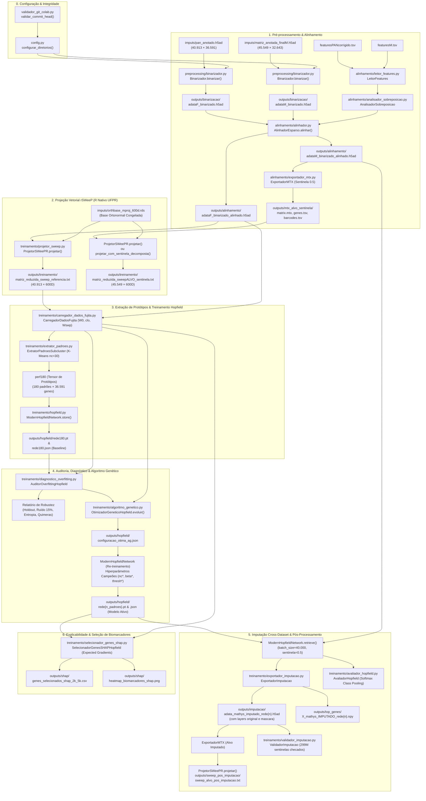

# Documentação do Pipeline Genérico Hopfield (Pan × Mathys)

> **Arquivo Base do Pipeline:** [`pipeline_generico_Pan_Mathys.ipynb`](file:///home/rasert/workspace/pipiline_hopifield/pipeline_generico_Pan_Mathys.ipynb) / [`pipeline_generico_Pan_Mathys.py`](file:///home/rasert/workspace/pipiline_hopifield/pipeline_generico_Pan_Mathys.py)  
> **Referência (Treinamento / Protótipos):** Dataset Pan / Fujita (`pan_anotado.h5ad`)  
> **Alvo (Consulta / Imputação):** Dataset Mathys (`matriz_anotada_finalM.h5ad`)  
> **Status:** Implementado e Operacional  
> **Idioma:** Português do Brasil (PT-BR)  

---

## 1. Visão Geral do Projeto

Este pipeline realiza a harmonização transcriptômica cross-dataset e a imputação de dados de sequenciamento de RNA de célula única (*scRNA-seq*) entre duas coortes humanas independentes de tecido cerebral:
- **Dataset de Referência (Pan / Fujita):** Contém ~40.000 células e 36.591 genes Ensembl nativos, abrangendo 7 linhagens celulares canônicas do córtex cerebral humano.
- **Dataset Alvo (Mathys):** Contém ~45.000 células e 32.643 genes Ensembl nativos, apresentando ~6.279 genes ausentes em relação ao atlas de referência.

O desafio central consiste em transferir programas transcricionais e reconstruir os genes ausentes no alvo sem sofrer com efeito de lote (*batch effect*), colapso dimensional ou distorção biológica. A arquitetura emprega uma **Modern Hopfield Network** (Ramsauer et al., 2020) com mecanismo de atenção contínua Softmax, combinada com a projeção ortogonal compacta **rSWeeP (600D)** (AIBIALab/UFPR), calibração evolutiva por **Algoritmo Genético** e explicabilidade genômica por **SHAP**.

---

## 2. Diagrama 1: Visão Conceitual e Científica (Nível Macro)

Este diagrama representa a perspectiva conceitual de alto nível das fases científicas do projeto, desenhado para reuniões com o orientador e apresentações em seminários.

---

## 3. Diagrama 2: Visão Técnico-Operacional e Fluxo de Dados (Nível Detalhado)

Este diagrama mapeia o fluxo físico e lógico entre os módulos em `src/`, os tensores em memória e os arquivos persistidos em disco. Foi estruturado para discussões com desenvolvedores e pesquisadores envolvidos na implementação.

---

## 4. Tabela de Dimensões Matriciais e Formatos de Artefatos

A tabela a seguir sumariza a evolução dimensional dos dados ao longo de cada etapa do pipeline:

| Etapa | Matriz / Objeto | Dimensão (Linhas × Colunas) | Formato em Disco | Caminho Típico |
| :--- | :--- | :--- | :--- | :--- |
| **Ingestão Referência** | `adata_ref` | 40.913 células × 36.591 genes | `.h5ad` (AnnData) | `imputs/pan_anotado.h5ad` |
| **Ingestão Alvo** | `adata_alvo` | 45.549 células × 32.643 genes | `.h5ad` (AnnData) | `imputs/matriz_anotada_finalM.h5ad` |
| **Binarização** | `X_bin` | Mesmas dimensões das entradas | `.h5ad` (Esparso CSR) | `outputs/binarizacao/*.h5ad` |
| **Alinhamento Referência** | `adata_ref_alin` | 40.913 células × 36.591 genes | `.h5ad` (Esparso CSR) | `outputs/alinhamento/adataF_binarizado_alinhado.h5ad` |
| **Alinhamento Alvo (Sentinela)** | `adata_alvo_alin` | 45.549 células × 36.591 genes | `.h5ad` / `.mtx` | `outputs/mtx_alvo_sentinela/matrix.mtx` |
| **Projeção SWeeP Referência** | `Wswp` | 40.913 células × 600 dimensões | `.txt` (Tabular tabular float32) | `outputs/treinamento/matriz_reduzida_sweep_referencia.txt` |
| **Projeção SWeeP Alvo Sentinela** | `Wswp_alvo_sent` | 45.549 células × 600 dimensões | `.txt` (Tabular float32) | `outputs/treinamento/matriz_reduzida_sweepALVO_sentinela.txt` |
| **Protótipos de Memória (Baseline)** | `perf180` | 180 padrões × 36.591 genes | Em memória (`np.ndarray`) | Derivado via K-Means no espaço 600D |
| **Modelo Hopfield Salvo** | Pesos da Rede | 180 memórias em 36.591 dimensões | `.pt` (PyTorch) + `.json` | `outputs/hopfield/rede180.pt` |
| **Protótipos Campeões (AG)** | `perf_otimo` | (nc* × 6) padrões × 36.591 genes | Em memória / `.pt` | `outputs/hopfield/rede{n_padroes}.pt` |
| **Recuperação Imputada (Alvo)** | `Wrecuperado_m` | 45.549 células × 36.591 genes | `.h5ad` (com camadas CSR) + `.npy` | `outputs/imputacao/adata_mathys_imputado_rede{n}.h5ad` |
| **Projeção SWeeP Pós-Imputação** | `Wswp_alvo_imp` | 45.549 células × 600 dimensões | `.txt` (Tabular float32) | `outputs/sweep_pos_imputacao/sweep_alvo_pos_imputacao.txt` |
| **Seleção Biomarcadores SHAP** | `df_features_shap` | 3.000 genes ranqueados × metadados | `.csv` (Polars / Pandas) | `outputs/shap/genes_selecionados_shap_2k_5k.csv` |

---

## 5. Descrição Detalhada das Etapas do Pipeline

### 5.1. Configuração e Integridade Fail Fast
- **Módulos:** [`src/config.py`](file:///home/rasert/workspace/pipiline_hopifield/src/config.py), [`src/utils/validador_git_colab.py`](file:///home/rasert/workspace/pipiline_hopifield/src/utils/validador_git_colab.py)
- **Operação:** No Google Colab, valida compulsoriamente se o `HEAD` da máquina virtual coincide exatamente com `EXPECTED_COMMIT` (definido no notebook). Interrompe imediatamente com instruções caso haja divergência (prevenindo execuções defasadas por esquecimento de `git push`). Configura a raiz de diretórios dinâmicos `output_<nome_ref>_<nome_alvo>/` e define a semente reproduzível (`SEED = 42`).

### 5.2. Binarização Transcricional
- **Módulo:** [`src/preprocessing/binarizador.py`](file:///home/rasert/workspace/pipiline_hopifield/src/preprocessing/binarizador.py) (`Binarizador`)
- **Operação:** Converte a matriz de contagens ou expressão normalizada contínua em presença/ausência biológica: valores estritamente maiores que zero tornam-se `1.0`, e zeros permanecem `0.0`. Preserva a esparsidade das matrizes originais e pula etapas caso o arquivo já exista em disco.

### 5.3. Alinhamento de Espaços Gênicos e Sentinela Neutra (0.5)
- **Módulos:** [`src/alinhamento/leitor_features.py`](file:///home/rasert/workspace/pipiline_hopifield/src/alinhamento/leitor_features.py), [`src/alinhamento/analisador_sobreposicao.py`](file:///home/rasert/workspace/pipiline_hopifield/src/alinhamento/analisador_sobreposicao.py), [`src/alinhamento/alinhador.py`](file:///home/rasert/workspace/pipiline_hopifield/src/alinhamento/alinhador.py), [`src/alinhamento/exportador_mtx.py`](file:///home/rasert/workspace/pipiline_hopifield/src/alinhamento/exportador_mtx.py)
- **Operação:**
  1. O `LeitorFeatures` higieniza os arquivos de anotação de genes removendo sufixos de versão Ensembl (ex.: `.1`, `.2`).
  2. O `AnalisadorSobreposicao` mapeia a interseção e identifica os genes exclusivos de cada estudo.
  3. O `AlinhadorEsparso` reordena as matrizes para a ordem de 36.591 genes da referência Pan.
  4. Para as células do alvo Mathys, os genes ausentes no sequenciamento original são preenchidos com o **valor sentinela 0.5**.
  5. O `ExportadorMTX` grava a matriz alinhada no formato Matrix Market acompanhada de `genes_referencia.tsv` e `barcodes.tsv`.

### 5.4. Projeção Compacta rSWeeP (600D) via R Nativo UFPR
- **Módulo:** [`src/treinamento/projetor_sweep.py`](file:///home/rasert/workspace/pipiline_hopifield/src/treinamento/projetor_sweep.py) (`ProjetorSWeePR`)
- **Operação:** Executa o pacote R oficial `rSWeeP` (AIBIALab/UFPR) via subprocesso R.
  - A base ortonormal `orthbase_mproj_600d.rds` gerada por `orthBase()` é **congelada** em disco.
  - As projeções da Referência, do Alvo Sentinela e do Alvo Pós-Imputação utilizam estritamente o mesmo `.rds`, garantindo que todas as células habitem o mesmo espaço vetorial latente de 600 dimensões sem distorções geométricas. Fallbacks sintéticos são terminantemente vetados.

### 5.5. Extração de Protótipos de Memória por Subcluster
- **Módulo:** [`src/treinamento/extrator_padroes.py`](file:///home/rasert/workspace/pipiline_hopifield/src/treinamento/extrator_padroes.py) (`ExtratorPadroesSubcluster`)
- **Operação:**
  - Aplica K-Means com `nc = 30` centróides para cada linhagem celular sobre as 600 dimensões do SWeeP.
  - Para cada centróide, seleciona a célula real binária mais próxima (`k = 1` ou vizinhos de consenso) na matriz original `W0` de 36.591 genes.
  - Gera o tensor de padrões de memória celular (`perf180` ou `perf210`).

### 5.6. Armazenamento na Modern Hopfield Network
- **Módulo:** [`src/treinamento/hopfield.py`](file:///home/rasert/workspace/pipiline_hopifield/src/treinamento/hopfield.py) (`ModernHopfieldNetwork`)
- **Operação:** Os padrões biológicos são armazenados diretamente na matriz de memória da rede Hopfield moderna em PyTorch. O modelo converte dados binários `{0, 1}` para o espaço bipolar `{-1, +1}`. Não há retropropagação ou época de treino iterativo; o armazenamento é imediato e preserva os atratores celulares.

### 5.7. Auditoria Formal de Overfitting e Robustez
- **Módulo:** [`src/treinamento/diagnostico_overfitting.py`](file:///home/rasert/workspace/pipiline_hopifield/src/treinamento/diagnostico_overfitting.py) (`AuditorOverfittingHopfield`)
- **Operação:** Submete a rede Hopfield a quatro testes de validação:
  1. **Holdout Estratificado (20%):** Avalia a acurácia de recuperação em células da referência nunca vistas durante a extração dos protótipos.
  2. **Estresse de Ruído Sintético:** Injeta *dropout* e *bit-flip* aleatórios a 5%, 15% e 30% para medir a profundidade das bacias de atração.
  3. **Entropia da Atenção Softmax:** Monitora se a temperatura inversa `beta` está saturando em 1-NN puro ou promovendo interpolação contínua.
  4. **Detecção de Estados Espúrios / Quimeras:** Identifica coativações anômalas de marcadores celulares antagônicos.

### 5.8. Otimização de Hiperparâmetros via Algoritmo Genético
- **Módulo:** [`src/treinamento/algoritmo_genetico.py`](file:///home/rasert/workspace/pipiline_hopifield/src/treinamento/algoritmo_genetico.py) (`OtimizadorGeneticoHopfield`)
- **Operação:**
  - Busca evolutiva com população de indivíduos e operadores de cruzamento, mutação e elitismo.
  - Otimiza conjuntamente: `nc` (protótipos por classe), `k_vizinhos`, `beta` (temperatura de atenção com escala por raiz da dimensão), `threshold`, `normalize` (similaridade cosseno esférica vs produto escalar) e `estrategia` (K-Means fixo vs dinâmico).
  - A função de aptidão (*fitness*) maximiza o F1-Macro de validação enquanto penaliza ativamente *gaps* de generalização, saturação entrópica e estados quiméricos.
  - O campeão é exportado para `outputs/hopfield/configuracao_otima_ag.json` e retreina a rede ativa (`rede{n_padroes}`).

### 5.9. Imputação Cross-Dataset via Atenção Softmax Contínua
- **Módulos:** [`src/treinamento/hopfield.py`](file:///home/rasert/workspace/pipiline_hopifield/src/treinamento/hopfield.py), [`src/treinamento/exportador_imputacao.py`](file:///home/rasert/workspace/pipiline_hopifield/src/treinamento/exportador_imputacao.py)
- **Operação:**
  - As células do Mathys contendo `0.5` nos genes ausentes são passadas como consulta (*query*) para a rede Hopfield ótima em mini-lotes (`batch_size = 40.000`).
  - No mapeamento bipolar `(x - 0.5) × 2`, o valor sentinela `0.5` torna-se exatamente `0.0`. Portanto, os genes ausentes exercem influência nula sobre o cálculo dos pesos de atenção Softmax.
  - A rede calcula a média ponderada dos protótipos de memória estáveis ativados e projeta a expressão imputada nos genes antes ausentes.
  - O `ExportadorImputacao` grava o arquivo AnnData `.h5ad` comprimido com camadas (`original`, `mascara_imputada`, `probabilidade_imputada`), metadados `obs`/`var` e arquivo `.npy`.

### 5.10. Avaliação por Softmax Class Pooling e Validação Biológica
- **Módulos:** [`src/treinamento/avaliador_hopfield.py`](file:///home/rasert/workspace/pipiline_hopifield/src/treinamento/avaliador_hopfield.py), [`src/treinamento/validador_imputacao.py`](file:///home/rasert/workspace/pipiline_hopifield/src/treinamento/validador_imputacao.py)
- **Operação:**
  - Agrega os pesos de atenção Softmax por classe biológica (`Softmax Class Pooling`) para predizer a linhagem celular de cada célula alvo.
  - Gera matriz de confusão, Precision, Recall e F1-Score por tipo celular.
  - O `ValidadorImputacao` audita centenas de milhões de valores sentinela substituídos e inspeciona se marcadores canônicos específicos do cérebro (ex.: neurônios excitatórios, oligodendrócitos, astrócitos) foram reconstruídos com fidelidade biológica.
  - Re-projeta o alvo imputado no espaço rSWeeP 600D com a base congelada.

### 5.11. Explicabilidade Genômica e Biomarcadores via SHAP
- **Módulo:** [`src/treinamento/selecionador_genes_shap.py`](file:///home/rasert/workspace/pipiline_hopifield/src/treinamento/selecionador_genes_shap.py) (`SelecionadorGenesSHAPHopfield`)
- **Operação:**
  - Aplica `shap.GradientExplainer` (Expected Gradients) diretamente sobre a função de atenção e classificação da rede Hopfield em mini-lotes *streaming*.
  - Utiliza os centróides médios das 7 classes como *background* de referência.
  - Identifica e ranqueia as 2.000 a 5.000 *features* gênicas mais discriminatórias para as linhagens celulares a partir dos 36.591 genes totais.
  - Produz o arquivo tabular `genes_selecionados_shap_2k_5k.csv`, o heatmap sinótico de marcadores normalizado e o gráfico sumário de impacto global.

---

## 6. Referências Arquiteturais (ADRs)

Para aprofundamento nas decisões técnicas formais do projeto, consulte as seguintes ADRs no *Second Brain*:
- **Binarização e Sentinela:** [`ADR 001`](file:///home/rasert/workspace/pipiline_hopifield/second_brain/04_Recursos/adrs/adr_001_binarizacao_expressao_genica.md), [`ADR 002`](file:///home/rasert/workspace/pipiline_hopifield/second_brain/04_Recursos/adrs/adr_002_sentinela_meio_genes_ausentes.md)
- **rSWeeP e Base Congelada:** [`ADR 004`](file:///home/rasert/workspace/pipiline_hopifield/second_brain/04_Recursos/adrs/adr_004_projecao_rsweep_600d_kmeans.md), [`ADR 019`](file:///home/rasert/workspace/pipiline_hopifield/second_brain/04_Recursos/adrs/adr_019_obrigatoriedade_rsweep_r_e_congelamento_orthbase.md), [`ADR 021`](file:///home/rasert/workspace/pipiline_hopifield/second_brain/04_Recursos/adrs/adr_021_centralizacao_orthbase_config_e_reuso_canonico.md)
- **Modern Hopfield Network & Otimização:** [`ADR 005`](file:///home/rasert/workspace/pipiline_hopifield/second_brain/04_Recursos/adrs/adr_005_rede_hopfield_moderna_parametros.md), [`ADR 020`](file:///home/rasert/workspace/pipiline_hopifield/second_brain/04_Recursos/adrs/adr_020_resolucao_sentinela_e_validacao_multinivel_imputacao.md), [`ADR 022`](file:///home/rasert/workspace/pipiline_hopifield/second_brain/04_Recursos/adrs/adr_022_otimizacao_hiperparametros_algoritmo_genetico.md)
- **Explicabilidade SHAP & Integridade Colab:** [`ADR 023`](file:///home/rasert/workspace/pipiline_hopifield/second_brain/04_Recursos/adrs/adr_023_selecao_features_shap_hopfield.md), [`ADR 024`](file:///home/rasert/workspace/pipiline_hopifield/second_brain/04_Recursos/adrs/adr_024_validacao_fail_fast_commit_colab.md)
