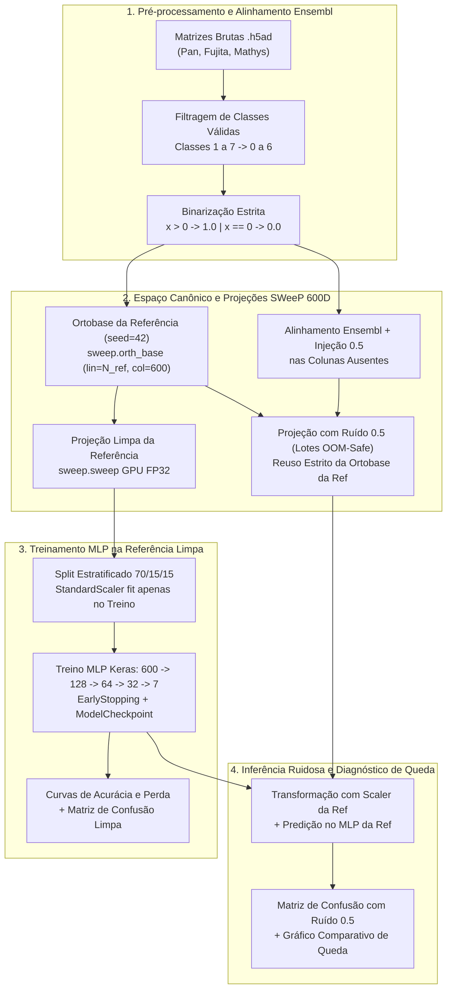
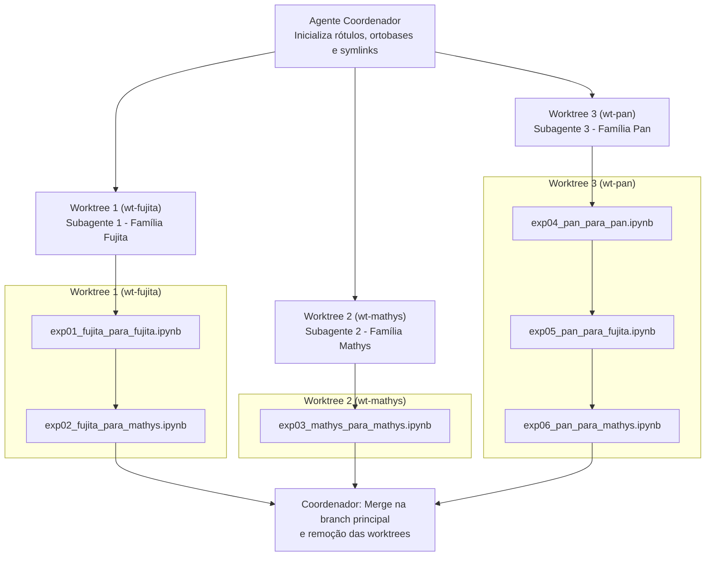

# 🧪 Plano Experimental: Validação de Sensibilidade ao Ruído (Sentinela 0.5) no Classificador Celular MLP com Projeções SWeeP 600D

> **Projeto Vinculado:** [[01_Projetos/proposta_mestrado/index|Projeto de Mestrado UFPR]]  
> **Repositório do Experimento:** `/home/rasert/workspace/Teste_MlP_fujita_para_fujitafaltante_fujitapos_imputacao`  
> **Status:** Plano Estruturado para Execução  
> **Data:** 24/10/2026  

---

## 1. Contextualização Científica e Motivação

No trabalho de mestrado de Leticia Astolpho Silvano ([[01_Projetos/proposta_mestrado/index|Proposta de Mestrado]]), emprega-se uma Rede Hopfield Moderna (*Dense Associative Memory*) combinada à projeção vetorial [[03_Conhecimento/projecao_rsweep_600d|rSWeeP (600D)]] para integrar coortes transcriptômicas de célula única (*scRNA-seq*) do córtex cerebral humano e imputar genes não medidos entre estudos.

Quando um classificador Multi-Layer Perceptron (MLP) é treinado em um dataset com maior número de genes e avaliado em outro dataset com menor número de genes, as variáveis ausentes recebem a [[03_Conhecimento/sentinela_meio_genes_ausentes|sentinela neutra 0.5]] antes da projeção na base ortonormal canônica compartilhada (600 dimensões).

### Hipótese a ser Comprovada
Se o classificador MLP for tolerante e mantiver alta acurácia mesmo com a inserção da sentinela `0.5` nas colunas ausentes, a etapa de reconstrução por rede Hopfield não se justificaria do ponto de vista de classificação. Por outro lado, se o MLP apresentar perda estatisticamente significativa de acurácia, F1-Score e aumento de entropia na classificação celular, **fica formalmente demonstrada a necessidade imperativa da imputação via Rede Hopfield Moderna**.

---

## 2. Diagrama de Fluxo Metodológico



---

## 3. Inventário Verificado de Dados e Dimensões

Todos os arquivos estão localizados no repositório de experimentos em `dados/`:

| Dataset | Caminho da Matriz (.h5ad) | Arquivo de Features (.tsv) | Arquivo de Rótulos | Total Células | Células Válidas (1 a 7) | Total Genes (Ensembl IDs) |
| :--- | :--- | :--- | :--- | :---: | :---: | :---: |
| **Pan** *(Maior)* | `dados/pan/pan_anotado.h5ad` | `dados/pan/featuresPANcorrigido.tsv` | `dados/pan/PanNumerico.csv` | 58.326 | **57.457** (98,51%) | **61.541** |
| **Fujita** *(Intermediário)* | `dados/fujita/matrizFiltradaeNormalizadaF (1).h5ad` | `dados/fujita/featuresF.tsv` | `dados/fujita/cell_types_binarioF.txt` | 40.913 | **26.763** (65,41%) | **36.601** |
| **Mathys** *(Menor)* | `dados/mathys/matriz_anotada_finalM.h5ad` | `dados/mathys/featuresM.tsv` | `dados/mathys/tipos_celulares_numericoMs.txt` | 47.523 | **45.572** (95,89%) | **32.738** |

### Relação de Sobreposição de Genes (Ensembl IDs sem sufixo de versão)
- **Interseção Global (Pan ∩ Fujita ∩ Mathys):** **30.287 genes** presentes nos 3 datasets.
- **Fujita × Mathys:** 30.358 genes comuns | **6.243 genes do Fujita ausentes no Mathys** (recebem 0.5) | 2.380 genes do Mathys fora do Fujita.
- **Pan × Fujita:** 36.476 genes comuns | **25.065 genes do Pan ausentes no Fujita** (recebem 0.5) | 125 genes do Fujita fora do Pan.
- **Pan × Mathys:** 30.923 genes comuns | **30.618 genes do Pan ausentes no Mathys** (recebem 0.5) | 1.815 genes do Mathys fora do Pan.

---

## 4. Estrutura dos 6 Experimentos

Os experimentos serão organizados na pasta `experimentos/` do repositório:

| # | Notebook | Treino MLP (Referência Limpa) | Inferência com Ruído (0.5) | Base Ortonormal Obrigatória | Regra da Máscara de Ruído (0.5) | Avaliação da Inferência Ruidosa |
| :-: | :--- | :--- | :--- | :---: | :--- | :--- |
| **1** | `exp01_fujita_para_fujita.ipynb` | **Fujita** (26.763 cél., split 70/15/15) | **Fujita com ruído** | `dados/fujita/orthbase_fujita_600d.npy` (36.601 × 600) | **União das ausências:** 6.314 genes ausentes em Pan ou Mathys recebem 0.5 (30.287 binários) | **Holdout Teste 15%** (4.015 cél.) e **Total 100%** (26.763 cél.) |
| **2** | `exp02_fujita_para_mathys.ipynb` | **Fujita** (26.763 cél., split 70/15/15) | **Mathys alinhado ao Fujita** | `dados/fujita/orthbase_fujita_600d.npy` (36.601 × 600) | **Cross-dataset:** 6.243 genes do Fujita ausentes no Mathys recebem 0.5 (30.358 binários) | **Dataset Mathys 100%** (45.572 cél. válidas) |
| **3** | `exp03_mathys_para_mathys.ipynb` | **Mathys** (45.572 cél., split 70/15/15) | **Mathys com ruído** | `dados/mathys/orthbase_mathys_600d.npy` (32.738 × 600) | **União das ausências:** 2.451 genes ausentes em Pan ou Fujita recebem 0.5 (30.287 binários) | **Holdout Teste 15%** (6.836 cél.) e **Total 100%** (45.572 cél.) |
| **4** | `exp04_pan_para_pan.ipynb` | **Pan** (57.457 cél., split 70/15/15) | **Pan com ruído** | `dados/pan/orthbase_pan_600d.npy` (61.541 × 600) | **União das ausências:** 31.254 genes ausentes em Fujita ou Mathys recebem 0.5 (30.287 binários) | **Holdout Teste 15%** (8.619 cél.) e **Total 100%** (57.457 cél.) |
| **5** | `exp05_pan_para_fujita.ipynb` | **Pan** (57.457 cél., split 70/15/15) | **Fujita alinhado ao Pan** | `dados/pan/orthbase_pan_600d.npy` (61.541 × 600) | **Cross-dataset:** 25.065 genes do Pan ausentes no Fujita recebem 0.5 (36.476 binários) | **Dataset Fujita 100%** (26.763 cél. válidas) |
| **6** | `exp06_pan_para_mathys.ipynb` | **Pan** (57.457 cél., split 70/15/15) | **Mathys alinhado ao Pan** | `dados/pan/orthbase_pan_600d.npy` (61.541 × 600) | **Cross-dataset:** 30.618 genes do Pan ausentes no Mathys recebem 0.5 (30.923 binários) | **Dataset Mathys 100%** (45.572 cél. válidas) |

---

## 5. Diretrizes de Implementação e Travas de Integridade

### 5.1. Proibição de Reescrita Algorítmica do SWeeP
- Deve-se utilizar estritamente o pacote oficial `sweep` (v2.2.0+) instalado no ambiente Python via CuPy GPU (`device="cuda"`, `dtype=np.float32`).
- A base ortonormal é calculada uma única vez para a referência com `sweep.orth_base(lin=N_genes, col=600, seed=42)`.

### 5.2. Projeção com Ruído 0.5 em Lotes OOM-Safe
- Para evitar estouro de memória RAM/VRAM ao densificar centenas de milhões de sentinelas `0.5`, o processamento de projeção com ruído deve ser feito em fatias de **2.500 células** (`CHUNK_SIZE = 2500`).
- Cada fatia é densificada em `float32`, preenchida com `0.5` nas colunas ausentes e projetada via `sweep.sweep()`, concatenando-se os resultados em `(N_celulas, 600)`.

### 5.3. Travas de Segurança (*Assertions Fail-Fast*) de Ortobase
Para garantir compatibilidade matemática estrita:
1. **Mesma Ortobase:** No Exp 02 (`Fujita -> Mathys`), é proibido carregar a ortobase do Mathys. O Mathys deve ser projetado com `orthbase_fujita_600d.npy`.
2. **Mesma Ortobase nos Exps 05 e 06:** Tanto o Fujita quanto o Mathys devem ser projetados com `orthbase_pan_600d.npy`.
3. **Validação Colunar:**
   ```python
   # Verificação de compatibilidade colunar Ensembl
   assert orthbase_ref.shape == (len(genes_ref), 600)
   for col_alvo, col_ref in zip(idx_alvo_arr[:50], idx_ref_arr[:50]):
       assert genes_alvo[col_alvo] == genes_ref[col_ref], "Divergência de pareamento Ensembl!"
   ```

### 5.4. Topologia e Treinamento do MLP
- **Arquitetura Keras:** `Input(600) -> Dense(128, relu) -> Dense(64, relu) -> Dense(32, relu) -> Dense(7, softmax)`.
- **Hiperparâmetros:** Otimizador Adam, perda `sparse_categorical_crossentropy`, 50 épocas, batch size 64.
- **Callbacks:** `EarlyStopping(monitor="val_loss", patience=5, restore_best_weights=True)` e `ModelCheckpoint`.
- **Escalonador:** `StandardScaler` ajustado apenas nos 70% de treino limpo e reutilizado na inferência com ruído.

### 5.5. Visualizações Obrigatórias por Notebook
1. Curvas interativas de acurácia e perda (Treino vs Validação ao longo das épocas).
2. Matriz de confusão baseline (Conjunto de Teste 15% limpo).
3. Matriz de confusão com ruído 0.5 (Holdout 15% e/ou 100% das células válidas).
4. Gráfico comparativo de barras de queda de métricas (Acurácia global, Macro F1 e Weighted F1 antes vs depois do ruído).

---

## 6. Arquitetura de Execução Paralela em Git Worktrees

### Análise de Hardware da Máquina
- **CPU:** Intel Core i5-7600 (4 núcleos / 4 threads físicos).
- **RAM:** 16 GB DDR4 (~8,4 GiB disponíveis livres).
- **GPU:** NVIDIA GeForce RTX 3060 (12 GB VRAM).

### Estratégia de Paralelismo Seguro (3 Worktrees por Família de Referência)
Executar 6 instâncias simultâneas de leitura `.h5ad` consumiria mais de 16 GB e causaria congelamento por OOM Killer. A estratégia recomendada consiste em criar **3 Git Worktrees paralelos**, agrupados pelo dataset de referência:



### Regras para os Worktrees
1. **Links Simbólicos Obrigatórios:** Como `.venv/` e `dados/` estão no `.gitignore`, cada worktree deve receber `ln -s .../.venv .venv` e `ln -s .../dados dados`.
2. **Controle de Threads:** Cada notebook deve limitar o paralelismo de CPU com `tf.config.threading.set_intra_op_parallelism_threads(2)` e `tf.config.threading.set_inter_op_parallelism_threads(1)`.
3. **Isolamento de Checkpoints:** Cada modelo deve ser salvo com o nome do experimento (ex: `modelo_mlp_exp01_fujita_para_fujita.keras`).

---

## 7. Critérios de Sucesso e Conclusão

- [ ] Todos os 6 notebooks criados em `experimentos/` e executados via `jupyter nbconvert`.
- [ ] Curvas de treino/perda e matrizes de confusão registradas nas saídas das células.
- [ ] Quantificação precisa da variação de acurácia com ruído 0.5 em cada um dos 6 cenários.
- [ ] Conclusão formal consolidada comprovando o impacto do ruído sentinela para justificar a imputação por Rede Hopfield Moderna.

---

## 🔗 Conexões no Grafo de Conhecimento

* [[01_Projetos/proposta_mestrado/index|Projeto de Mestrado UFPR (Leticia Astolpho Silvano)]]
* [[01_Projetos/pipeline_hopfield_expandido/index|Pipeline Hopfield Expandido]]
* [[03_Conhecimento/sentinela_meio_genes_ausentes|Sentinela Neutra 0.5]]
* [[03_Conhecimento/projecao_rsweep_600d|Projeção rSWeeP 600D]]
* [[03_Conhecimento/binarizacao_expressao_genica|Binarização de Expressão Gênica]]
* [[03_Conhecimento/alinhamento_ensembl_cross_dataset|Alinhamento Canônico Ensembl]]
* [[04_Recursos/adrs/index|Índice de ADRs]]
