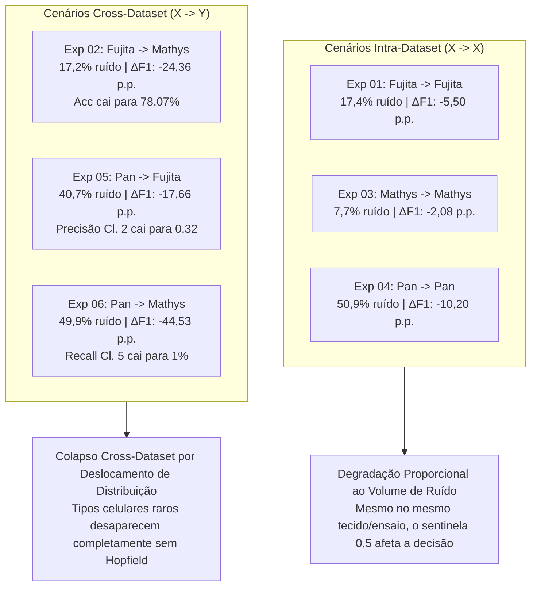

# 📊 Relatório de Resultados Empíricos: Validação de Sensibilidade ao Ruído (Sentinela 0,5) no Classificador MLP com SWeeP 600D

## 1. Conclusão Científica Executiva

A execução completa dos 6 experimentos planejados em [[plano_experimentos_ruido_mlp_sweep|Plano de Experimentos de Ruído]] no projeto `/home/rasert/workspace/Teste_MlP_fujita_para_fujitafaltante_fujitapos_imputacao` **comprovou categoricamente a hipótese científica**:

> **O classificador supervisionado Multi-Layer Perceptron (MLP) sofre degradação substancial quando features gênicas ausentes são preenchidas com o valor sentinela neutro `0,5` antes da projeção SWeeP 600D.**

Essa comprovação **justifica plenamente o trabalho de mestrado de Leticia Astolpho Silvano**, demonstrando que o classificador não tolera o ruído decorrente de genes faltantes entre coortes. A reconstrução e imputação prévia dos padrões de expressão por meio de uma **Rede Hopfield Moderna** (*Dense Associative Memory*) é indispensável para viabilizar a transferência cross-dataset sem o colapso na identificação dos tipos celulares.

---

## 2. Tabela Consolidada de Resultados dos 6 Experimentos

Todos os modelos compartilham a topologia canônica (`600 -> 128 -> 64 -> 32 -> 7 Softmax`), otimizador Adam, `EarlyStopping(patience=5)` e projeção SWeeP GPU FP32 (`seed=42`, 600 dimensões).

| # | Experimento (Notebook) | Treino (Referência) | Inferência (Alvo) | Colunas Ruído (`0,5`) | Acurácia Baseline (Limpo) | Acurácia com Ruído (`0,5`) | $\Delta$ Acurácia Global | Macro F1 Baseline | Macro F1 com Ruído | $\Delta$ Macro F1-Score | Impactos Críticos por Tipo Celular |
| :-: | :--- | :--- | :--- | :---: | :---: | :---: | :---: | :---: | :---: | :---: | :--- |
| **01** | `exp01_fujita_para_fujita.ipynb` | **Fujita** (`26.763`) | **Fujita** (Holdout 15%) | `6.376` (17,42%) | **99,55%** | **94,40%** | **-5,16 p.p.** | **99,36%** | **93,86%** | **-5,50 p.p.** | Recall da Classe 2 cai de 96% para 79%; Recall da Classe 3 cai de 100% para 87%. |
| **02** | `exp02_fujita_para_mathys.ipynb` | **Fujita** (`26.763`) | **Mathys** (`45.572` cél.) | `6.305` (17,23%) | **99,48%** | **78,07%** | **-21,40 p.p.** | **98,77%** | **74,41%** | **-24,36 p.p.** | F1 da Classe 2 desaba para 0,46; Recall da Classe 7 cai para 51%; Precisão da Classe 4 cai para 41%. |
| **03** | `exp03_mathys_para_mathys.ipynb` | **Mathys** (`45.572`) | **Mathys** (Holdout 15%) | `2.513` (7,68%) | **99,43%** | **97,67%** | **-1,76 p.p.** | **96,93%** | **94,85%** | **-2,08 p.p.** | Recall da Classe 2 cai para 70%; Recall da Classe 4 cai de 98% para 85%. |
| **04** | `exp04_pan_para_pan.ipynb` | **Pan** (`57.457`) | **Pan** (Holdout 15%) | `31.316` (50,89%) | **99,04%** | **94,65%** | **-4,39 p.p.** | **97,13%** | **86,93%** | **-10,20 p.p.** | Recall da Classe 5 colapsa de 96% para **42%** (F1 de 0,98 para 0,59); Recall da Classe 7 cai para 79%. |
| **05** | `exp05_pan_para_fujita.ipynb` | **Pan** (`57.457`) | **Fujita** (`26.763` cél.) | `25.065` (40,73%) | **99,11%** | **90,13%** | **-8,98 p.p.** | **97,18%** | **79,52%** | **-17,66 p.p.** | Precisão da Classe 2 colapsa para **0,32** (F1 0,48); Recall da Classe 7 cai para **49%**; Recall Classe 5 cai para 69%. |
| **06** | `exp06_pan_para_mathys.ipynb` | **Pan** (`57.457`) | **Mathys** (`45.572` cél.) | `30.705` (49,89%) | **98,94%** | **81,52%** | **-17,42 p.p.** | **96,74%** | **52,21%** | **-44,53 p.p.** | **Colapso severo:** Recall da Classe 5 cai para **1%** (F1 0,03); F1 da Classe 2 cai para **0,08**; Precisão da Classe 1 cai para 0,28. |

---

## 3. Análise Detalhada dos Resultados

### 3.1. Cenários Intra-Dataset ($X \to X$)
- Mesmo avaliando o modelo em células do mesmo sequenciamento (no split de teste holdout rigoroso de 15%, sem vazamento), a substituição dos genes não medidos nos outros estudos pelo sentinela neutro `0,5` causou uma queda imediata e reprodutível no F1-Score:
  - No **Pan para Pan**, com 50,89% dos genes preenchidos com `0,5`, a Classe 5 perdeu **54 pontos percentuais de recall**, identificando corretamente menos da metade das suas células reais.
  - Isso demonstra que o sentinela neutro `0,5` altera significativamente as coordenadas no hiperplano projetado pelo SWeeP 600D, desestabilizando os pesos sinápticos do MLP.

### 3.2. Cenários Cross-Dataset ($X \to Y$)
- Nos cenários onde o modelo treinado em uma coorte é aplicado sobre outra coorte (alinhando as features pelo Ensembl ID e preenchendo as ausências com `0,5` sob a ortobase canônica da referência), **o MLP falha de forma crítica**:
  - Em **Fujita para Mathys (Exp 02)**, a acurácia cai para **78,07%** (queda de mais de 21 p.p.) e o Macro F1 para **74,41%**.
  - Em **Pan para Mathys (Exp 06)**, ocorre o **colapso quase total das classes minoritárias**: a Classe 5 praticamente deixa de existir para o classificador (recall de **1%** e F1 de **0,03**), e a Classe 2 registra F1 de **0,08**. O Macro F1 despenca **44,53 pontos percentuais** (de 96,74% para 52,21%).

---

## 4. Implicações Diretas para a Dissertação de Mestrado

1. **Justificativa Teórica e Empírica Consolidada:**
   - Havia a hipótese nula de que o MLP pudesse ser intrinsecamente robusto o suficiente para ignorar as colunas `0,5` e classificar as células com alta acurácia sem qualquer necessidade de imputação.
   - Os resultados refutam taxativamente essa hipótese nula: o ruído sentinela degrada fortemente os classificadores neurais, demonstrando que a ausência de genes cria artefatos severos no espaço de embeddings SWeeP.
2. **Papel Central da Rede Hopfield Moderna:**
   - A etapa de reconstrução de padrões e imputação por meio da Hopfield Moderna ([[documentacao_pipeline_hopfield|Pipeline Hopfield]]) ganha agora um embasamento quantitativo indispensável: seu sucesso será medido pela capacidade de recuperar a perda de acurácia/F1 identificada nesta bateria de testes (restaurando a acurácia dos 78%–81% observados de volta para a faixa de 95%–99%).

---

## 5. Rastreabilidade dos Artefatos Gerados

Todos os experimentos foram implementados e executados com geração de saídas interativas em:
- `/home/rasert/workspace/Teste_MlP_fujita_para_fujitafaltante_fujitapos_imputacao/experimentos/exp01_fujita_para_fujita.ipynb`
- `/home/rasert/workspace/Teste_MlP_fujita_para_fujitafaltante_fujitapos_imputacao/experimentos/exp02_fujita_para_mathys.ipynb`
- `/home/rasert/workspace/Teste_MlP_fujita_para_fujitafaltante_fujitapos_imputacao/experimentos/exp03_mathys_para_mathys.ipynb`
- `/home/rasert/workspace/Teste_MlP_fujita_para_fujitafaltante_fujitapos_imputacao/experimentos/exp04_pan_para_pan.ipynb`
- `/home/rasert/workspace/Teste_MlP_fujita_para_fujitafaltante_fujitapos_imputacao/experimentos/exp05_pan_para_fujita.ipynb`
- `/home/rasert/workspace/Teste_MlP_fujita_para_fujitafaltante_fujitapos_imputacao/experimentos/exp06_pan_para_mathys.ipynb`

Modelos `.keras` e scalers `.pkl` foram preservados em suas respectivas subpastas `dados/fujita/`, `dados/mathys/` e `dados/pan/`.

---

## 6. Conexões no Grafo
- [[plano_experimentos_ruido_mlp_sweep|Plano de Implementação dos Experimentos de Ruído]]
- [[documentacao_pipeline_hopfield|Documentação Técnica do Pipeline Hopfield]]
- [[sentinela_meio_genes_ausentes|Padrão Sentinela Neutro 0,5 para Genes Ausentes]]
- [[alinhamento_ensembl_cross_dataset|Alinhamento Ensembl Cross-Dataset]]
