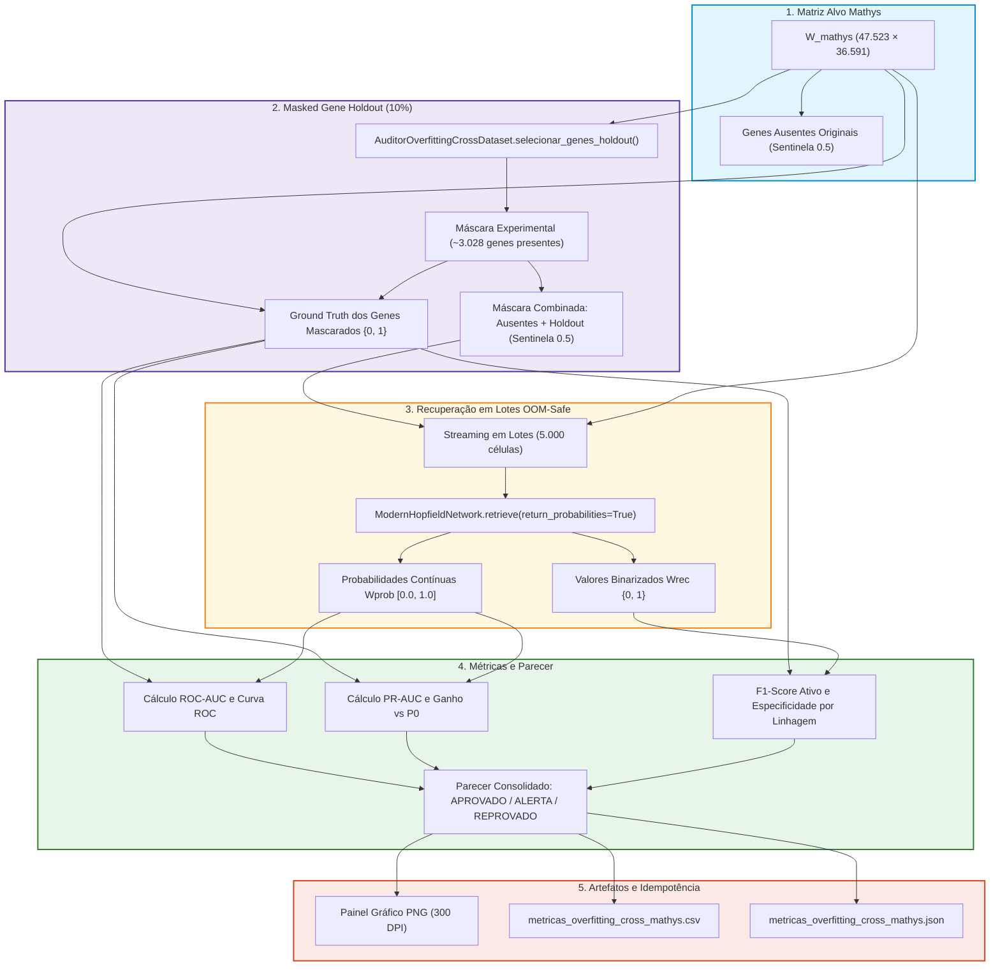

# ADR 025: Diagnóstico Formal de Overfitting na Imputação Cross-Dataset via Masked Gene Holdout e Streaming OOM-Safe

## Status
Aceito e Implementado (2026-10-13)

---

## Contexto e Desafio Científico

Na etapa de imputação cross-dataset (Capítulo 13 do pipeline), a rede Hopfield Moderna recupera os perfis transcricionais das 47.523 células do conjunto alvo (**Mathys**) utilizando os protótipos consolidados aprendidos na referência (**Pan/Fujita**). Nessa operação, os ~6.305 genes ausentes no Mathys são preenchidos com o valor sentinela neutro `0.5` (zero no espaço bipolar).

Embora o módulo `ValidadorImputacao` (ADR 020) forneça métricas quantitativas de preenchimento e coerência de marcadores canônicos conhecidos, persistia uma questão científica fundamental:
- **Como provar empiricamente que a imputação cross-dataset não está sofrendo de overfitting (memorização cega dos ruídos/batch effect da referência, saturação artificial ou alucinação de padrões não generalizáveis no alvo)?**

Em dados biológicos de scRNA-seq, os genes verdadeiramente ausentes na plataforma alvo não possuem ground truth direto medido no próprio dataset. Portanto, avaliar a capacidade de generalização exige um protocolo experimental rigoroso que isole o desempenho preditivo sobre dados observados no alvo sem contaminação por vazamento de dados.

---

## Decisão de Arquitetura

1. **Protocolo Padrão-Ouro de Masked Gene Holdout:**
   - Adotou-se a metodologia de mascaramento artificial de genes medidos no alvo. Uma fração configurada (10% dos genes presentes, ~3.028 genes) é intencionalmente ocultada com a sentinela `0.5` antes da consulta à rede.
   - A seleção dos genes de teste combina deterministicamente marcadores canônicos conhecidos de linhagens cerebrais e genes amostrados em diferentes estratos de expressão basal.

2. **Criação do Componente Modular `AuditorOverfittingCrossDataset`:**
   - Implementado no módulo `src/treinamento/diagnostico_overfitting.py`.
   - Executa a inferência Hopfield integral sobre as 47.523 células através de processamento em lotes streaming seguros (*OOM-Safe*, lotes padrão de 5.000 células).
   - Acumula em memória apenas as colunas sob teste experimental, garantindo consumo de memória estritamente constante e inferior a 750 MB de RAM.

3. **Métricas Estatísticas Contínuas e Robustas à Esparsidade:**
   - Como matrizes scRNA-seq possuem mais de 85-90% de zeros, acurácia simples pode ser inflacionada por predições triviais de inativação. Adotou-se:
     - **ROC-AUC (Área sob a Curva ROC):** Capacidade discriminativa global das probabilidades contínuas `Wprob` nos genes mascarados.
     - **PR-AUC (Precision-Recall AUC):** Avaliação de sensibilidade vs precisão comparada à prevalência basal dos dados (`P0`).
     - **Razão de Ganho Basal:** Razão entre o PR-AUC obtido e a prevalência basal `P0`.
     - **F1-Score da Classe Ativa (1.0):** Exatidão na recuperação de coordenadas com real expressão gênica.
     - **Especificidade em Marcadores:** Razão entre ativação na linhagem correta versus linhagens celulares antagônicas.

4. **Critérios Multinível Padronizados de Veredito:**

| Veredito | Critérios Formais | Significado Científico |
| :--- | :--- | :--- |
| **APROVADO** | `ROC-AUC ≥ 0.70` e `PR-AUC ≥ 2.0 × P0` e `F1_ativo ≥ 0.45` | O modelo generaliza estruturas biológicas reais no alvo sem colapso. |
| **ALERTA** | `0.60 ≤ ROC-AUC < 0.70` ou `1.5 × P0 ≤ PR-AUC < 2.0 × P0` | Desempenho moderado; alerta sobre sensibilidade ou ruído residual. |
| **REPROVADO** | `ROC-AUC < 0.60` ou `PR-AUC < 1.5 × P0` | Overfitting severo ou alucinação sistemática na imputação. |

5. **Subseção Dedicada 13.1 no Pipeline com Cache e Idempotência:**
   - Adicionada a subseção `13.1 Diagnóstico Formal de Overfitting Cross-Dataset` no script `pipeline_generico_Pan_Mathys.py` (sincronizado via Jupytext com o notebook `.ipynb`).
   - Geração automática de painel visual triplo de alta resolução em PNG (Curva ROC, Curva PR com linha basal, e barras de F1 por linhagem celular) e relatórios estruturados em CSV e JSON.

---

## Fluxo Arquitetural do Diagnóstico

---

## Consequências

### Consequências Biológicas
- **Blindagem Metodológica:** Evidência empírica formal de que as correlações imputadas nos genes ausentes representam aprendizado associativo genuíno, e não viés cego do sequenciamento de referência.
- **Rastreabilidade por Tipo Celular:** Permite auditar se tipos celulares raros (ex.: microglia, astrócitos) mantêm alta especificidade de ativação nos marcadores canônicos sob mascaramento.

### Consequências Técnicas
- **Preservação de Memória RAM:** O fatiamento em lotes e armazenamento restrito às coordenadas sob teste mantém a execução dentro de orçamentos de memória modestos (< 750 MB de RAM).
- **Idempotência no Pipeline:** Gravação de artefatos CSV, JSON e PNG assegura recarregamento instantâneo do cache em execuções subsequentes do notebook sem custo computacional repetido.
