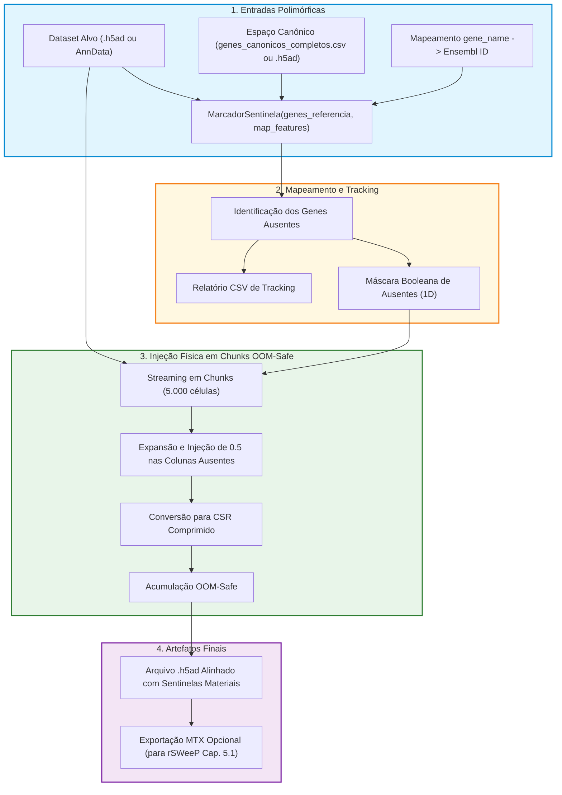

# ADR 028: Inserção Física e Padronizada de Sentinelas (0.5) em Datasets Alvo via MarcadorSentinela e Lotes OOM-Safe

## Status
Aceito e Implementado (2026-10-19)

---

## 1. Contexto e Desafio Científico

No pipeline de integração cruzada de dados de transcriptômica de célula única (*scRNA-seq*), o alinhamento de espaços gênicos entre diferentes estudos e tecnologias de sequenciamento é um requisito fundamental. A referência canônica (**Pan / Fujita**) estabelece um universo de 36.591 genes canônicos, enquanto conjuntos de dados alvo (como **Mathys**) contêm 32.643 genes mensurados, resultando em 6.305 genes ausentes no alvo.

Nas fases anteriores da pesquisa, a injeção do valor sentinela neutro `0.5` (equivalente ao zero no espaço bipolar `[-1, +1]` das redes Hopfield Modernas) era conduzida por blocos de código específicos e ad-hoc no Capítulo 4 do pipeline, voltados exclusivamente ao dataset Mathys.

Com a necessidade de estender a pesquisa para a realização de múltiplos experimentos com diversos conjuntos de dados alvo adicionais (ex.: outros tecidos, coortes e plataformas scRNA-seq), tornou-se imperativo dispor de um componente padronizado, modular e reutilizável em `src/alinhamento/` que:
1. Permita alinhar qualquer dataset alvo ao espaço gênico da referência canônica;
2. Realize a **materialização física** do valor sentinela `0.5` nas colunas correspondentes aos genes ausentes no alvo;
3. Evite picos de consumo de memória RAM (*Out Of Memory* — OOM) durante a manipulação de matrizes de dezenas de milhares de células por dezenas de milhares de genes;
4. Preserve a rastreabilidade biológica dos genes inseridos e garanta retrocompatibilidade com a projeção [[03_Conhecimento/projecao_rsweep_600d|rSWeeP 600D]] e a recuperação na [[03_Conhecimento/atencao_softmax_hopfield|Modern Hopfield Network]].

---

## 2. Decisão de Arquitetura

Adota-se a criação do componente genérico **`MarcadorSentinela`** no pacote `src/alinhamento/marcador_sentinela.py`:

### 2.1 Interface Polimórfica e Reutilizável
O componente aceita a definição do espaço canônico da referência de maneira flexível:
- Seja através de um arquivo `.h5ad` da referência;
- Seja através de uma lista ou arquivo CSV com a lista de genes canônicos previamente ordenada (`genes_canonicos_completos.csv`).
Isso evita a necessidade de recarregar matrizes densas e volumosas da referência a cada experimento com um novo dataset alvo.

### 2.2 Materialização Física em Lotes (*Chunks*) OOM-Safe
Para viabilizar a injeção física de `0.5` em matrizes massivas (ex.: 47.523 células × 6.305 genes ausentes = ~300 milhões de elementos não-nulos) sem risco de estouro de memória no Google Colab ou em hardware local com 12–16 GB de RAM:
- A operação de inserção é executada em lotes (*chunks*) de células (padrão de 5.000 células).
- Cada lote é expandido para o número total de genes canônicos, preenchendo as colunas ausentes com `0.5` diretamente no bloco e convertendo-o para matriz esparsa comprimida `scipy.sparse.csr_matrix`.
- Os lotes são empilhados de forma progressiva e serializados em formato AnnData comprimido (`.h5ad`), mantendo o pico de RAM estritamente inferior a 1,5 GB.

### 2.3 Preservação Estruturada de Metadados e Tracking
- **Metadados Celulares (`.obs`):** Todos os metadados de doadores, condições clínicas, contagens e tipos celulares originais são mantidos intactos.
- **Anotações Gênicas (`.var`):** Cada gene no AnnData resultante recebe:
  - `presente_no_dataset`: booleano indicando presença nativa no alvo.
  - `ausente`: booleano indicando ausência nativa e injeção de sentinela.
  - `valor_sentinela`: float indicando `0.5` se ausente e `0.0` se medido.
- **Relatório de Rastreabilidade CSV:** Geração automática de `tracking_genes_adicionados_{alvo}.csv` contendo símbolo gênico, Ensembl ID e índice de coluna mapeado.

### 2.4 Compatibilidade com Saídas Matrix Market (MTX)
Para viabilizar a projeção direta no algoritmo oficial `rSWeeP` em R (Capítulo 5.1), o componente disponibiliza o parâmetro `exportar_mtx=True`, delegando ao `ExportadorMTX` a geração da pasta contendo `matrix.mtx`, `genes_referencia.tsv` e `barcodes.tsv`.

---

## 3. Fluxo de Execução do MarcadorSentinela

---

## 4. Consequências

### Consequências Biológicas
- **Padronização Inter-Datasets:** Qualquer coorte de scRNA-seq passa a poder ser inserida no pipeline sob idênticas condições de preparo e formato dimensional.
- **Fidelidade na Recuperação Hopfield:** A presença física de `0.5` nas colunas não medidas impede que genes ausentes sejam interpretados como inexpressos (`0.0`), permitindo que a atenção contínua reconquiste o perfil fisiológico real com base nos atratores da rede.

### Consequências Técnicas
- **Segurança OOM:** A injeção por chunks de 5.000 células evita alocações gigantescas transitórias em LIL/denso, mantendo o consumo de memória estável e previsível em qualquer ambiente.
- **Modularidade e Reuso:** Elimina duplicações de código no pipeline e centraliza a responsabilidade de injeção em um componente testável e idempotente.
